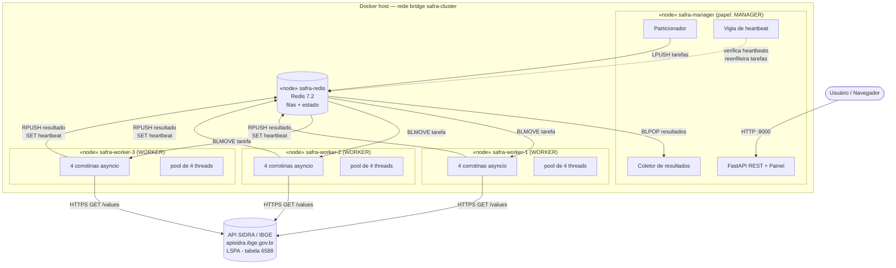
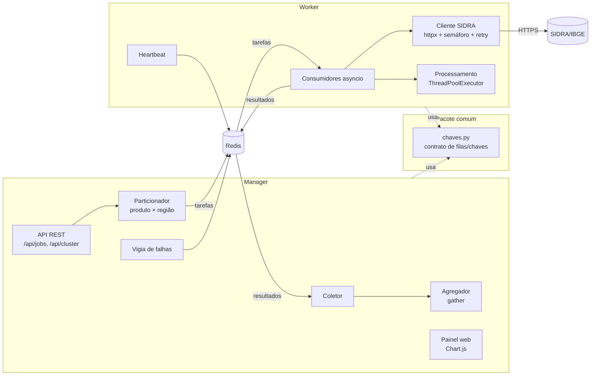
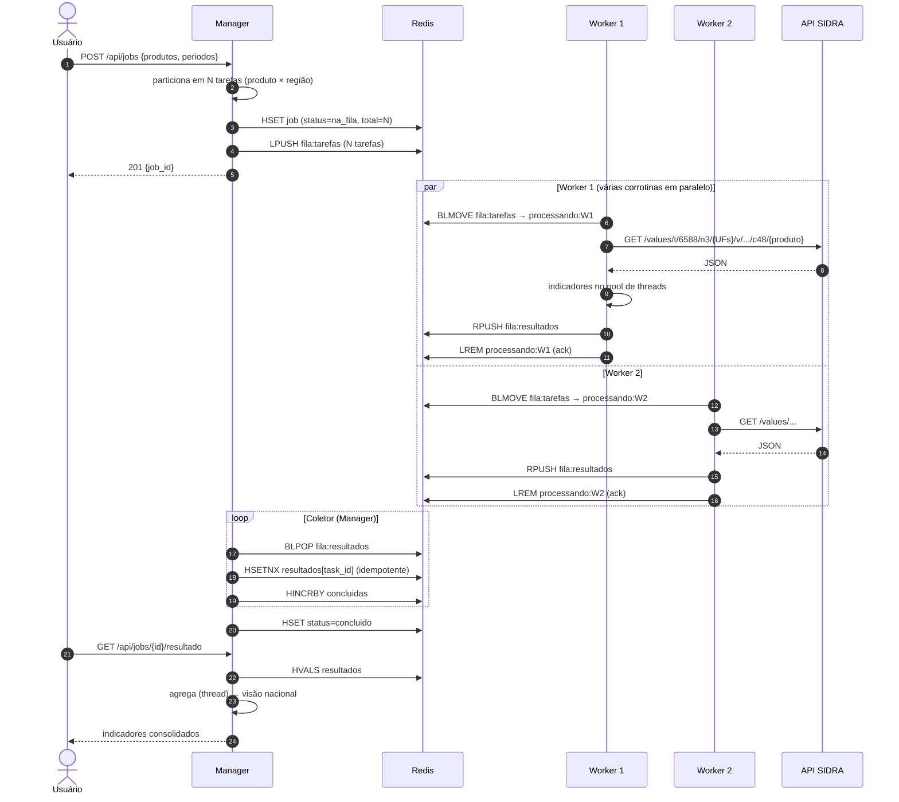
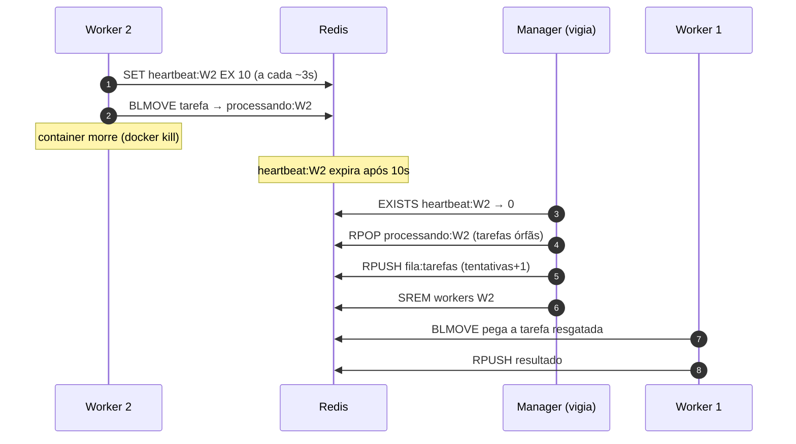
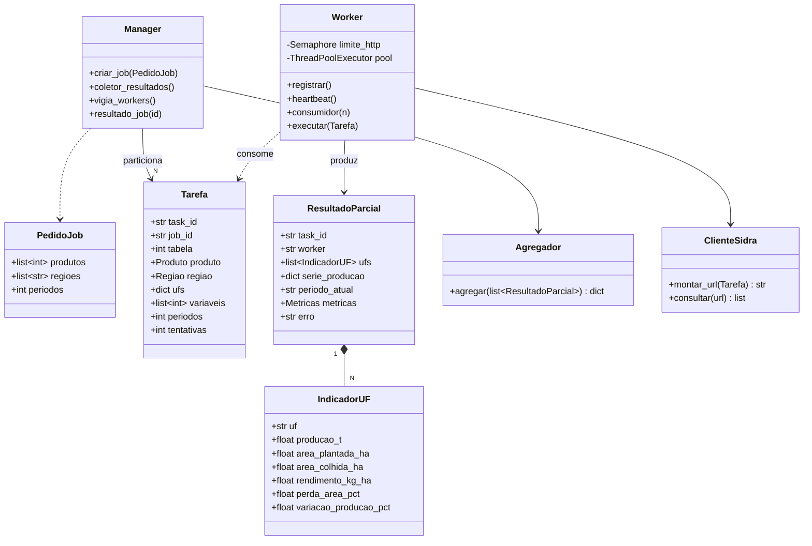
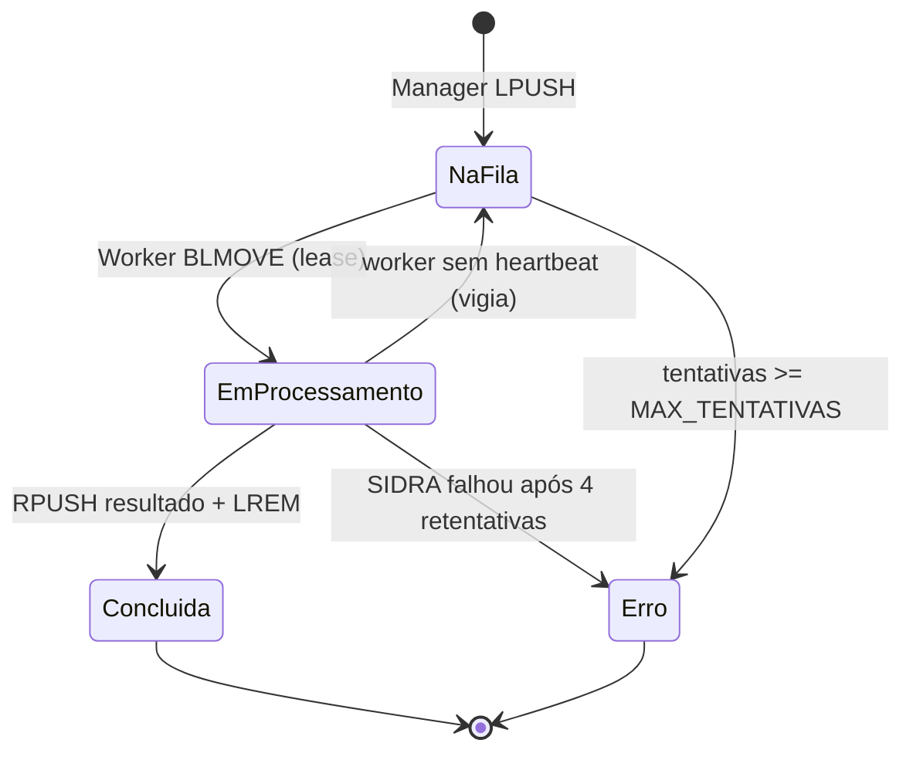
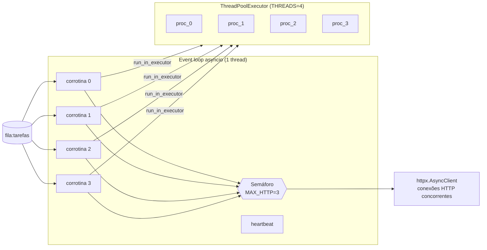

# Arquitetura da Solução — Safra Distribuída

Os diagramas estão em Mermaid (o GitHub renderiza direto no navegador). Para exportar em PNG/SVG para os slides, use <https://mermaid.live>.

## 1. Topologia distribuída

**Estilo:** Manager/Worker (mestre-trabalhador) com **fila de trabalho compartilhada** (*work queue*) e **scatter-gather**:

1. O **Manager** (coordenador) recebe um pedido de análise e o **particiona** em tarefas independentes: `produto × macrorregião` (10 produtos × 5 regiões = 50 tarefas no job padrão).
2. As tarefas vão para uma fila no **Redis**. Qualquer **Worker** livre pega a próxima (*pull*): o balanceamento de carga é natural, e um worker mais rápido simplesmente pega mais tarefas.
3. Cada Worker consulta a **API SIDRA/IBGE** (LSPA, tabela 6588), calcula os indicadores e devolve um **resultado parcial**.
4. O Manager **coleta e consolida** (*gather*) os parciais na visão nacional.

| Nó | Papel | Quantidade | Tecnologia |
|---|---|---|---|
| `safra-manager` | Coordenador: API REST, particionamento, coleta, detecção de falhas, painel | 1 | Python 3.12, FastAPI, asyncio |
| `safra-worker-1..3` | Processamento: consumo da fila, I/O com o SIDRA, cálculo de indicadores | N (3 por padrão, escalável) | Python 3.12, asyncio, httpx, ThreadPoolExecutor |
| `safra-redis` | Broker de mensagens + estado compartilhado | 1 | Redis 7.2 |

### Por que estas escolhas

- **Fila *pull* em vez de *push* (RPC do Manager para os Workers):** o Manager não precisa conhecer os endereços dos Workers. Basta subir mais um container para escalar (`docker service scale` no Swarm).
- **Redis como broker:** listas com operações atômicas (`BLMOVE`) entregam semântica de *at-least-once* com pouca infraestrutura. Também guarda o estado do cluster (heartbeats, contadores e resultados).
- **Particionamento produto × região:** gera tarefas de tamanho parecido e independentes entre si (sem coordenação entre Workers), e cada requisição ao SIDRA fica pequena (respostas rápidas, menos risco de timeout).
- **Tolerância a falhas:** heartbeat com TTL + *lease* por worker + reenfileiramento pelo Manager + consolidação idempotente (`HSETNX`).

## 2. Diagrama de implantação (Docker)

## 3. Diagrama de componentes

## 4. Diagrama de sequência — execução de um job

## 5. Diagrama de sequência — falha de um Worker

## 6. Diagrama de classes

## 7. Ciclo de vida da tarefa (estados)

## 8. Paralelismo interno de um Worker

- **I/O (HTTP ao SIDRA e Redis):** assíncrono. Enquanto uma corrotina espera a rede, as outras continuam. O semáforo limita as conexões simultâneas para respeitar o servidor do IBGE.
- **CPU (parse e indicadores):** delegado a um pool de threads, para que o event loop continue livre para responder ao heartbeat e consumir novas tarefas.
