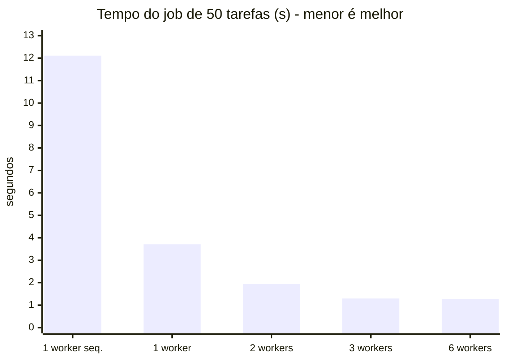

# Benchmark — ganho do paralelismo

**Cenário:** job padrão (10 produtos × 5 regiões = **50 tarefas**, 13 meses de estimativa), consultando a API SIDRA real. Cada cenário teve 1 job de aquecimento e depois **3 repetições**. A tabela mostra a **mediana**.

Medição de 12/11/2026, com Manager, Workers e Redis rodando como processos separados na mesma máquina (Windows 11), com a mesma configuração do `docker-compose.yml`. Os tempos dependem da latência do SIDRA naquele momento, então os valores absolutos variam. O que importa é a proporção entre os cenários.

| Cenário | Workers | Paralelismo interno por worker | Tempo (mediana) | Speedup vs. sequencial | Tarefas por worker |
|---|---|---|---|---|---|
| Sequencial | 1 | 1 corrotina, 1 conexão HTTP | 12,11 s | 1,0x | 50 |
| Só paralelismo interno | 1 | 4 corrotinas, 3 conexões HTTP | 3,71 s | **3,3x** | 50 |
| Distribuído | 2 | 4 corrotinas, 3 conexões HTTP | 1,94 s | 6,2x | 24 / 26 |
| Distribuído (padrão) | 3 | 4 corrotinas, 3 conexões HTTP | 1,30 s | **9,3x** | 16 / 16 / 18 |
| Distribuído | 6 | 4 corrotinas, 3 conexões HTTP | 1,27 s | 9,5x | 9 / 7 / 7 / 10 / 9 / 8 |



## Leitura dos resultados

1. **Paralelismo interno (asyncio):** com um único Worker, passar de 1 para 4 corrotinas reduziu o tempo de 12,1 s para 3,7 s. O trabalho é dominado por espera de rede (I/O), e as corrotinas sobrepõem essas esperas.
2. **Distribuição entre nós:** de 1 para 2 Workers o tempo cai quase pela metade (1,9x), e com 3 Workers o ganho chega a 2,9x em relação a 1 Worker. Isso é praticamente linear.
3. **Balanceamento automático:** como os Workers *puxam* tarefas da fila, a carga se divide sozinha (16/16/18 com 3 Workers), sem o Manager precisar decidir quem faz o quê.
4. **Saturação:** de 3 para 6 Workers quase não há ganho (1,30 s → 1,27 s). Com 50 tarefas de cerca de 300 ms cada, o limite passa a ser a latência do SIDRA e o tamanho do job, não a capacidade de processamento. Para aproveitar mais nós, os jobs precisam ser maiores (mais produtos ou mais meses). Essa é a Lei de Amdahl na prática.
5. **Instabilidade do SIDRA:** na primeira repetição sequencial, a API do IBGE ficou instável. O job levou 60 s e 4 tarefas falharam mesmo após as retentativas. Por isso usamos a mediana, e isso mostra por que a política de retentativa com *backoff* existe. Nos cenários paralelos não houve falhas.

## Como reproduzir com Docker

Com o cluster no ar (`docker compose up --build -d`):

```bash
python scripts/benchmark.py --docker --repeticoes 3
```

O script liga 1, 2 e 3 Workers com `docker compose stop/start`, mede cada cenário e imprime a tabela em Markdown. Para medir o cenário sequencial, altere `CONCORRENCIA: "1"` e `MAX_HTTP: "1"` no `docker-compose.yml`.
